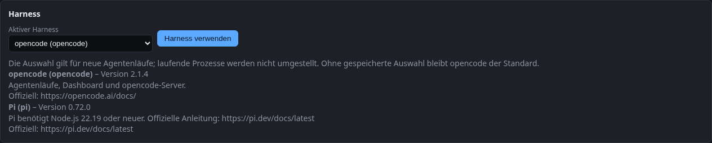

# AP04 — Austauschbares Coding-Harness und Pi

Stand: 2026-11-07
Ausgangscommit: `3be48de`
Arbeitsbranch: `feature/ap04-harness-alternatives`

## Ziel

vibe soll nicht mehr fest an opencode gebunden sein. Auswahl, Diagnose,
Einrichtung, Modellliste und Start des ausführenden Coding-Harness liegen in
einer eigenen Schicht. opencode bleibt der Standard, damit bestehende
Installationen unverändert weiterlaufen. Pi ist der erste alternative Harness
und am Ende dieses Arbeitspakets für Agentenläufe nutzbar.

## Fachliche Umsetzung

### Harness wählen

Die Auswahl wird in `<Zustand>/harness.json` gespeichert. Reihenfolge:

1. `VIBE_HARNESS` für genau diesen Prozess (auch aus dem Läufer).
2. Gespeicherte Auswahl in `harness.json`.
3. Fehlt die Datei, bleibt opencode der Default.

Eine vorhandene, aber ungültige oder unlesbare Datei wird gemeldet. Sie fällt
nicht still auf opencode zurück, damit ein Tippfehler nicht unbemerkt einen
anderen Harness startet.

### Setup

- `python3 scripts/setup-vibe.py --harness pi` wählt Pi bei der Installation.
- Bei interaktiver Erstinstallation fragt der Setup nach dem Harness und nennt
  opencode als Standard.
- Ein späteres Update ohne `--harness` behält die gespeicherte Auswahl.
- Die Werkzeugprüfung richtet sich nach dem Harness: opencode verlangt
  `opencode`, Pi verlangt `node` (22.19+) und `pi`.
- Der Setup nennt offiziellen Bezug, Hinweis und Installationsbefehl. Fehlende
  Werkzeuge werden wie bisher nur nach Zustimmung installiert; der Pi-Befehl
  ist `npm install -g --ignore-scripts @earendil-works/pi-coding-agent`.

### Oberfläche

Die Ansicht „Umgebung“ enthält eine Harness-Karte. Sie zeigt den aktiven
Harness, den Status beider Harnesses (Version, vorhanden/fehlend), den
Einrichtungshinweis und den Installationsbefehl. Ein Wechsel wird über
`POST /api/harness` gespeichert und gilt für neue Agentenläufe; laufende
Prozesse werden nicht umgestellt. Die Kopfzeile nennt den aktiven Harness.
`GET /api/server` liefert zusätzlich `harness` und `server_supported`; bei Pi
ist der opencode-Server nicht Teil des Laufs.

### Oberflächennachweis

Echtes Dashboard, Umgebungsansicht mit Harness-Karte (Playwright-Screenshot):



### CLI

```
vibe harness status
vibe harness list
vibe harness use pi
vibe harness setup pi
```

`status`/`list` diagnostizieren beide Harnesses ohne Modellaufruf. `use`
speichert die Auswahl. `setup` zeigt Hinweis, offiziellen Bezug und
Installationsbefehl.

### Agentenlauf mit Pi

Der Läufer liest die Auswahl und startet weiterhin opencode unverändert, wenn
opencode gewählt ist. Bei Pi:

```
pi --print --no-session [--model <provider/modell>] [--name <titel>] -- <prompt>
```

Pi liest keine opencode-Agentendateien. vibe liest deshalb den Prompt-Text der
gewählten Agentendatei (Projekt vor global), entfernt das Frontmatter und
stellt ihn der Aufgabe voran. Der Agentenname wird vorher validiert; die
Übergabe erfolgt als Argumentliste ohne Shell. `--no-session` hält den Lauf
frei von Sitzungsdateien in `~/.pi/agent` und ist Voraussetzung dafür, dass Pi
in der Schreib-Sandbox mit nur lesend eingebundenem Wurzeldateisystem läuft.

Die Modellliste der Agentenverwaltung kommt aus dem aktiven Harness:
opencode über den bestehenden Adapter, Pi über `pi --list-models`. Der Parser
akzeptiert die Tabelle von Pi 1.5.0 (`provider`, `model`, `context`, `max-out`,
`thinking`, `images`) und die einfache Form `provider/modell` je Zeile.

## Technische Umsetzung

| Datei | Änderung |
| --- | --- |
| `bin/vibe_harness.py` | neue Schicht: Registry, Auswahl lesen/schreiben, Diagnose, Einrichtungsplan, Agenten-Prompt, Startbefehl, Modellliste, CLI |
| `bin/vibe` | Import, `vibe harness`, Harness in `models_list` und `doctor`, Menüeintrag |
| `bin/vibe-run.sh` | liest die Auswahl, prüft sie, startet opencode unverändert oder Pi über `vibe_harness.py run` |
| `bin/vibe-web.py` | `GET/POST /api/harness`, Harness im Serverstatus |
| `bin/web/app.js` | Harness-Karte in „Umgebung“, Harness in der Kopfzeile |
| `scripts/setup-vibe.py` | `--harness`, interaktive Erstwahl, harnessabhängige Werkzeugprüfung, Pi-Installationsbefehl, Speichern der Auswahl |
| `docs/compatibility.md` | Harness-Schicht und Pi-Grenzen |
| `README.md` | Harness-Auswahl im Setup, CLI und Oberfläche |
| `docs/import-manifest.json` | Prüfsummen und AP04-Eintrag |

## Tests

Die Tests wurden in dieser Sitzung vom Umsetzungsagenten geschrieben, weil der
konfigurierte Test-Agent (`TESTER=test-agent`) nicht aufrufbar war; der Aufruf
über `subagent` wurde mit `Permission denied: subagent` verweigert. Die
Herkunft ist damit **nicht** unabhängig und wird hier offen ausgewiesen. Die
Tests arbeiten mit temporären Verzeichnissen und Attrappen für `opencode` und
`pi`; es gibt keine echten Modell- oder Netzaufrufe. Sie enthalten echte
Zusicherungen; es wurden keine Prüfungen abgeschwächt, übersprungen oder
gelöscht. Die Rot-Phase wurde vor der Implementierung beobachtet (siehe
unten).

### Red–Green-Nachweis

Der Ausgangsstand `3be48de` wurde mit `git archive` in ein temporäres
Verzeichnis entpackt, die neuen Tests wurden dorthin kopiert und gegen den
alten Code ausgeführt. Nach dem Kopieren von `bin/vibe_harness.py` in den
Ausgangsstand schlug die Setup-Integration nachweislich fehl:

```
$ python3 -m unittest tests.unit.test_setup_vibe -v
...
FAIL: test_pi_install_command_is_an_argument_list
AssertionError: Lists differ: [] != [['npm', 'install', '-g', '--ignore-script[34 chars]nt']]
...
Ran 6 tests in 0.023s
FAILED (failures=1, errors=5)
```

Ohne das neue Modul scheiterten beide Testdateien bereits beim Import mit
`ModuleNotFoundError: No module named 'vibe_harness'`.

Nach der Implementierung:

```
$ python3 -m unittest tests.unit.test_harness tests.unit.test_setup_vibe -v
Ran 27 tests in 0.233s
OK
```

Browserabnahme:

```
$ python3 -m unittest tests.browser.test_harness_ui -v
Ran 2 tests in 1.276s
OK
```

Der Browserlauf verwendete den bereits vorhandenen Playwright-Browser-Cache
über `PLAYWRIGHT_BROWSERS_PATH`; im Repository steht kein persönlicher Pfad.

### Abgedeckte Fälle

- Default bleibt opencode ohne Auswahl; gespeicherte Auswahl überlebt einen
  neuen Lesevorgang; `VIBE_HARNESS` hat Vorrang und wird validiert.
- Ungültige Auswahl und beschädigtes JSON werden gemeldet; opencode wird nicht
  still eingesetzt.
- Diagnose: vorhandenes, fehlendes, fehlschlagendes und versionloses Programm.
- Einrichtungsplan für Pi und opencode; installierter Harness braucht keinen
  Installationsbefehl.
- Argumentliste für opencode unverändert; Pi im Print-Modus mit Agentenprompt;
  Pi ohne Agentendatei wird abgelehnt.
- Modellliste von Pi aus der Tabellenausgabe; fehlendes Pi wird als Fehler
  gemeldet.
- CLI `harness use` und `harness status`; unbekannter Harness bleibt ohne
  Änderung.
- Setup: Erstinstallation speichert die Wahl, Update behält sie, Trockenlauf
  nennt den Pi-Befehl, Werkzeugprüfung ist harnessabhängig.
- Oberfläche: Harness sichtbar, Pi wählbar, Auswahl bleibt nach Neuladen
  erhalten, Kopfzeile nennt den aktiven Harness.

## Prüfungen

Ausgeführt am 2026-11-07 im Arbeitsbaum `feature/ap04-harness-alternatives`:

```
$ bash scripts/verify.sh quick
OK: 55 Dateien stimmen mit docs/import-manifest.json überein.
OK: 87 Python-, 8 Bash- und 4 JSON-Datei(en) syntaktisch geprüft.
OK: keine Geheimnisse erkannt.
OK: Prüfung 'quick' erfolgreich. (Exit 0)
```

```
$ bash scripts/verify.sh full
...
Ran 902 tests in 111.877s
Ran 60 tests in 49.442s
OK: Tests erkannt: 962 (Minimum 1).
OK: Prüfung 'full' erfolgreich. (Exit 0)
```

Hinweis zur Prüfumgebung: Der vollständige Lauf braucht ein beschreibbares
`/tmp` und keine geerbten `SANDBOX`/`SANDBOX_TOOLS`- oder Laufzeit-`VIBE_*`-
Variablen. Mehrere bestehende Läufertests legen Übergabedateien unter `/tmp`
ab und übernehmen die Umgebung des Aufrufers. In einer abgeschotteten
Agentenumgebung wurde die Prüfung deshalb in einem eigenen Mount-Namespace mit
beschreibbarem `/tmp` und bereinigter Umgebung ausgeführt. Der Ausgangsstand
`3be48de` scheitert in einer Umgebung mit schreibgeschütztem `/tmp` an
denselben Läufertests (belegt für `test_run_control`), nicht an AP04.

## Grenzen

- Pi wurde in dieser Umgebung nicht installiert. Geprüft wurden die offizielle
  CLI-Dokumentation und der Quelltext von Pi 1.5.0, nicht ein echter
  Modellaufruf.
- Die Agentenverwaltung bleibt auf das opencode-Dateiformat ausgelegt. Pi
  nutzt dieselben Dateien nur als Prompt-Quelle; Subagenten und Rechteprüfung
  von opencode gibt es bei Pi nicht.
- Pi-Projektkonfiguration unter `.pi` wird im Print-Modus ohne
  Vertrauensentscheidung nicht geladen. `AGENTS.md` liest Pi weiterhin.
- MCP-Verwaltung und opencode-Server bleiben opencode-spezifisch.
- Die Kostenerfassung liest die opencode-Sitzungsdatenbank; für Pi-Läufe gibt
  es noch keine Kostenzuordnung.
- Pi-Sitzungen werden nicht fortgesetzt (`--no-session`).

## Dokumentation

- Fachlich und technisch: diese Datei.
- Kompatibilität und Pi-Aufrufe: `docs/compatibility.md`.
- Trilium: siehe `docs/trilium-index.md`.
